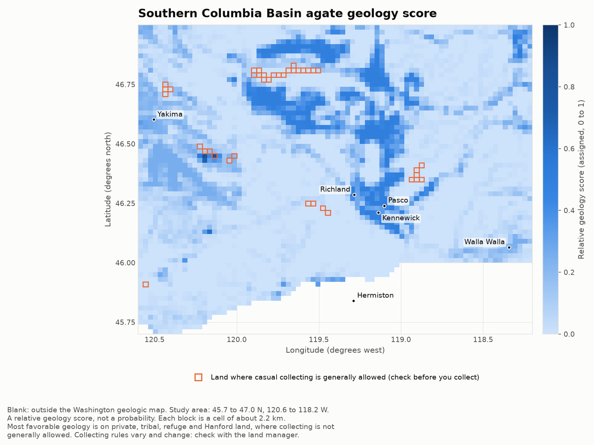

# Columbia Basin agate map

A geology-only heat map of the southern Columbia Basin in Washington, from Yakima to Walla Walla (45.7 to 47.0 N, 120.6 to 118.2 W). It scores every 2.2 km cell by how much of its surface geology is coarse river or flood gravel, the kind of deposit this project assumes can hold agate and petrified wood, using the Washington DNR 1:100,000 geologic map reclassified with documented weights. A second layer outlines the land where casual rock collecting is generally allowed. Both layers are downloaded at build time from public services.



The interactive version is `output/columbia_basin_agate_map.html` after you build it. It has the same two layers, and you can switch the outline layer off. There are no collecting sites or markers; the PNG labels six towns for orientation.

## Where you can collect

Most of the favorable geology is on land where collecting is not generally allowed. Counting the area of geology with a weight of 0.5 or more inside the study area:

| Land | Share of the favorable geology |
|---|---|
| No public-land record (mostly private) | 75.3% |
| Hanford Site (Department of Energy) | 11.4% |
| National wildlife refuges and monuments | 5.3% |
| Other public or designated land (state, local, easements) | 5.9% |
| Military land | 0.9% |
| Tribal reservations | 0.8% |
| Collecting-eligible land (the orange outlines) | 0.5% |

The outlined land is Bureau of Land Management and national forest land with no special designation. Of the 134 cells that score 0.5 or more, one is outlined. The numbers are rough: PAD-US has gaps, and a reservation boundary encloses private parcels. They are in `data/build_info.json`. Collecting rules vary and change, so check with the land manager before you collect anything. See Collecting rules.

## Status

- **The numbers.** The study area holds 5,200 cells. 4,433 are scored. The other 767 are blank because the Washington geologic map does not cover them, mostly in Oregon. 2,558 scored cells (58%) score above 0, and 134 (3%) score 0.5 or more. The median score is 0.01. Collecting-eligible land totals about 388 square kilometers, 1.5 percent of the study area, and 39 cells are mostly that land and are outlined.
- **Scores are assigned, not measured.** Each geologic unit has a weight I chose from its description and the sources below. Nothing was fitted to or checked against reports of finds. A score is a relative ranking, not a probability.
- **The geology is generalized.** A 1:100,000 map shows surface units only. A thin gravel under loess, or a small outcrop, will not appear.
- **The outline is a screening rule, not a legal finding.** Mining claims, local closures, seasonal limits and permit requirements are not in the data.
- **Not done.** The study area stops at 47.0 N and 118.2 W, so Moses Lake, Quincy, Grand Coulee and most of the Channeled Scabland are outside it, and so is the northern and eastern part of the basin. Oregon is not covered. State trust land and other agencies' land are not outlined. I did not test the weights against independent data.

## How the score works

Geologic units come from the Washington Geological Survey 1:100,000 surface geology (map unit codes such as `PLMcg(r)`). The premise is that agate and petrified wood reach the surface as pebbles and cobbles carried by rivers and floods, so coarse river or flood gravel is more likely to hold them than basalt, loess, dune sand or slack-water silt. That is an assumption of this project. The sources below do not test it.

| Weight | Units | Why |
|---|---|---|
| 1.0 | Ringold Formation conglomerate (`PLMcg(r)`); Ellensburg Formation gravel (`Mcg`, `Mcg(e)`, `Mcg(es)`) | DNR describes these as well-rounded pebble to cobble gravel or conglomerate with quartzite, granitic, metamorphic and volcanic clasts, and the Ellensburg gravels as deposited by the ancestral Columbia River. Pebbles of petrified wood are reported in the Ellensburg gravels (Beck, 1937). The one hobbyist article I found on Columbia Basin agates reports only rumors of agates in gravels of the ancestral Columbia, Salmon, Clearwater and Snake River drainages (Landon, 2019). That is weak support. |
| 0.5 | "Missoula, glacial Lake, deposits of", gravel units (`Qfg`, `Qfg(1)` to `Qfg(4)`) and "Missoula flood deposits, backwater gravel of" (`Qf(bg)`); Pliocene to Pleistocene gravels (`QPLcg` fan and terrace gravel, `QMcg` pebble to cobble gravel, `PLcg(t)` Thorp Gravel); Ringold Formation fluvial and lake facies (`PLMc(r)`); Pliocene-Miocene interbedded fluvial and lake deposits with pebble lenses (`PLMc`); Pleistocene-Miocene fluvial gravel, sand, silt and clay (`QMc`) | Gravel that may be reworked from the units above, or finer deposits with some gravel. The flood gravels carry diverse clasts, including quartzite, but are diluted with local basalt. |
| 0.25 | Ellensburg Formation sandstone and siltstone (`Mc(e)`, `Mc(ev)`); Miocene fluvial sand, silt and gravel beds (`Mc`); fanglomerate (`PLMaf`); alluvium and terrace deposits (`Qa`, `Qaf`, `Qafo`, `Qt`) | Finer or mixed deposits that include some conglomerate or pebble beds. |
| 0 | Everything else | Basalt flows, loess, dune sand, slack-water flood silt (`Qfs`), landslide deposits, lake deposits, fill, water. |

The Frenchman Springs Member of the Wanapum Basalt is left at 0. Petrified wood is reported in the Ginkgo flow near Vantage (Campbell and Reidel, 1991), a flow within that member, and the 1:100,000 map does not separate that flow from the rest of the member.

A cell's score is the area-weighted mean of the unit weights over the part of the cell that the geologic map covers:

```
score = sum(weight(unit) x area of unit in the cell) / area of the cell that the map covers
```

A cell is scored if the map covers at least half of it. Otherwise it is blank. The weights live in `agate_map/units.py`. In the DNR map the Missoula flood deposits are grouped as "Pleistocene outburst flood deposits", and the gravel units (`Qfg`) are named "Missoula, glacial Lake, deposits of". They do not appear under the name Hanford formation. The gravel units carry a weight. The slack-water sand and silt units (`Qfs`) do not.

## The collecting-eligible outline

A cell is outlined if at least half of it is land that meets all of these conditions. If a rule is uncertain, the land is excluded. The outline does not change a cell's score.

1. PAD-US 4.1 lists it as fee-owned Bureau of Land Management or Forest Service land, with Open public access and GAP status 3 (multiple use).
2. The BLM Surface Management Agency layer agrees that it is BLM or Forest Service land. This is the generalized `LimitedScale` service, so its edges are approximate.
3. No other PAD-US polygon overlaps it. Wilderness, areas of critical environmental concern, wild and scenic river corridors, national monuments, roadless areas, easements, wildlife refuges, military and tribal land, state and local units, and Department of Energy land all sit in other polygons, so any overlap removes the land.

This step takes the BLM and Forest Service land in the study area from about 520 to about 390 square kilometers. Both numbers are in `data/build_info.json`.

Washington DNR trust land is excluded on purpose. The Washington Geological Survey's rockhounding page says personal collecting is allowed "for the most part" on state and federal lands, and its list of places where rockhounding is not permitted includes State Trust lands. I could not reconcile the two, so the land is out.

### Collecting rules

These pages were current when I read them. Rules change, so read them again.

- **BLM.** "Reasonable amounts of rocks, mineral specimens" for personal use, not for sale or barter. Up to 25 pounds plus one piece of petrified wood per day, and no more than 250 pounds per person per year. No collecting at picnic sites, campgrounds or similar developed sites, or on mining claims without the claimholder's permission ([BLM](https://www.blm.gov/learn/can-i-keep-this)).
- **National forests.** Rules differ by forest and ranger district. Some allow casual collecting without a permit. Others require a free-use permit, and 36 CFR 228.62 provides for free-use permits for limited quantities of petrified wood ([Legal Information Institute text of 36 CFR 228.62](https://www.law.cornell.edu/cfr/text/36/228.62)). Contact the ranger district. Little national forest land in the study area is outlined.
- **Hanford Site (Department of Energy).** Closed to the public. The National Park Service says public access is permitted only through a tour run by the Department of Energy ([NPS](https://www.nps.gov/mapr/planyourvisit/hanford-tours.htm)).
- **National monuments and wildlife refuges.** Not outlined. For example, the U.S. Fish and Wildlife Service says of the Hanford Reach National Monument: "All collecting is prohibited, including antlers, bones, rocks, artifacts and plant life" ([rules](https://www.fws.gov/national-monument/hanford-reach/visit-us/rules-policies)).
- **Private and tribal land.** You need the owner's or the tribe's permission.
- **Washington DNR.** See above ([DNR rockhounding page](https://dnr.wa.gov/node/457)).

## Requirements

- Python 3.12. The pinned versions were tested on 3.12.
- The packages in `requirements.txt`: folium, branca, matplotlib, numpy, requests and shapely.
- Internet access to rebuild the grid, and to open the HTML map (base map tiles and Leaflet scripts). Drawing the PNG needs none.

## Build and run

```
python -m venv .venv
source .venv/bin/activate        # on Windows: .venv\Scripts\activate
pip install -r requirements.txt
python -m agate_map
```

`python -m agate_map` reads `data/scored_grid.csv` and writes `output/columbia_basin_agate_map.html` and `output/columbia_basin_agate_map.png` (1600 px wide). The PNG in `docs/` is that output, copied there for this page.

To rebuild the scored grid from the live services, run:

```
python -m agate_map rebuild
```

That downloads the geologic map (about 7,700 polygons), PAD-US and BLM Surface Management Agency polygons for the study area into `data/raw/` (about 11 MB, not committed), rescores every cell, rewrites `data/scored_grid.csv` and `data/build_info.json`, and draws the map. It takes a minute or two. Add `--refresh` to ignore a cached download. The services change over time, so a rebuild months from now can give different cells.

`data/scored_grid.csv` has one row per scored cell: the cell center, the score, and the share of the cell that is collecting-eligible land.

## Tests

```
pip install -r requirements-dev.txt
python -m pytest
```

There are 69 tests, and none uses the network. They cover the lattice and the grid file, the unit weights, the land rules on synthetic polygons, the scoring arithmetic (including cells outside the geologic map), the land-class split, the batched download and its checks, and the rendering: both layers must be present, the HTML must contain no markers or per-cell tooltips, the PNG must be 1600 px wide with no metadata, and both files must be written.

## Data sources and terms

The downloads are not stored in this repository. Only the derived grid is. None of these layers is a legal survey.

- **Surface geology, 1:100,000.** Washington Geological Survey, 2026, Surface geology, 1:100,000, GIS data, February 2026: Digital Data Series DS-18, version 4.0, through the DNR ArcGIS service `Public_Geology/100K_Surface_Geology_WA_GeMS` (layer 11, map units). The Survey says its materials may be used for commercial and non-commercial purposes if the source is cited, and its digital data come with no warranty ([disclaimers and citation guidelines](https://dnr.wa.gov/node/118)). The grid here is that map reclassified by the weights above.
- **PAD-US 4.1.** U.S. Geological Survey Gap Analysis Project, 2025, Protected Areas Database of the United States (PAD-US) 4.1: U.S. Geological Survey data release, https://doi.org/10.5066/P96WBCHS, through the USGS ArcGIS Online layer `Manager_Name_PADUS`. A U.S. government data release. Cite it as above.
- **BLM Surface Management Agency.** Bureau of Land Management, the `BLM_Natl_SMA_LimitedScale` service at gis.blm.gov. A federal agency data set, in its generalized limited-scale form. The service description says it classifies federal land by managing agency below about 1:36,000 scale "for efficiency", so parcel edges are approximate.
- **Base map.** USGS The National Map, USGS Topo tile service, used only in the interactive map.

The service metadata for PAD-US and the BLM layer gives a citation but no license text. Read each provider's current terms before you reuse the data.

References for the weights:

- Beck, G.F., 1937, Determination of fossil woods (basswood in Ellensburg Formation): The Mineralogist, v. 6, no. 1, p. 13. Cited from the Central Washington University repository record (https://digitalcommons.cwu.edu/cotsfac/843), which lists 1937 in the recommended citation and 1938 as the publication date. Reports isolated, rounded pebbles of petrified wood in the Ellensburg gravels.
- Campbell, N.P., and Reidel, S.P., 1991, Geologic guide for State Routes 240 and 243 in south-central Washington: Washington Geology, v. 19, no. 3, p. 3-17. Reports petrified wood in the Ginkgo flow of the Frenchman Springs Member near Vantage.
- Landon, J., 2019, Columbia Basin agates: Rock & Gem, https://www.rockngem.com/columbia-basin-agates/. A hobbyist article, not a peer-reviewed source. It reports rumors of agates in gravels of the ancestral Columbia, Salmon, Clearwater and Snake River drainages, says the agates have been transported long distances, and says the source formation is not known.

Further reading on the units and the floods. These describe the geology. None of them tests the weights or says where agate occurs.

- Benito, G., and O'Connor, J.E., 2003, Number and size of last-glacial Missoula floods in the Columbia River valley between the Pasco Basin, Washington, and Portland, Oregon: Geological Society of America Bulletin, v. 115, no. 5, p. 624-638. https://doi.org/10.1130/0016-7606(2003)115%3C0624:NASOLM%3E2.0.CO;2
- Bjornstad, B.N., and Lanigan, D.C., 2007, Geologic descriptions for the solid-waste low level burial grounds: Pacific Northwest National Laboratory, PNNL-16887. Gives the stratigraphic order: the Ringold Formation lies on Columbia River basalt and beneath the Cold Creek unit and the Hanford formation.
- Bretz, J H., 1969, The Lake Missoula floods and the channeled scabland: Journal of Geology, v. 77, no. 5, p. 505-543.
- Lindsey, K.A., 1996, The Miocene to Pliocene Ringold Formation and associated deposits of the ancestral Columbia River system, south-central Washington and north-central Oregon: Washington Division of Geology and Earth Resources, Open File Report 96-8.

## Credits

Written by Connor Hansen. The base map is from USGS The National Map. The map is drawn with Leaflet through folium, the PNG with matplotlib, and the geometry work uses shapely.

## License

MIT. See `LICENSE`.
